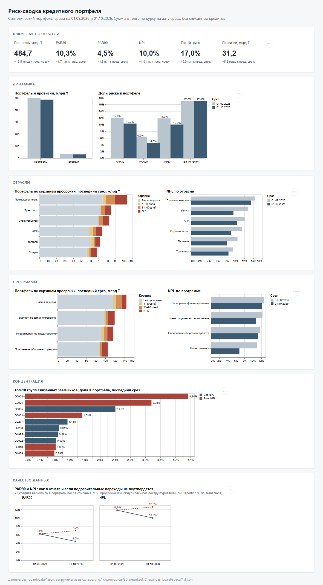

# Риск-сводка кредитного портфеля

Мини-проект: PostgreSQL 16 → семантическая модель YAML → дашборд на Vega-Lite. Синтетический портфель, срезы на 01.09.2026 и 01.10.2026

**Демо:** https://diantre-hh.github.io/loan-portfolio-risk-dashboard/dashboard/ — та же статичная страница из `dashboard/`, на данных из `dashboard/data/*.json`



## Как запустить

Нужны Docker (или любой PostgreSQL 16) и `psql`. Все команды из корня репозитория

```bash
docker run -d --name arqa-pg -e POSTGRES_PASSWORD=postgres -p 5432:5432 postgres:16
```

```bash
PGPASSWORD=postgres psql -h localhost -U postgres -v ON_ERROR_STOP=1 -f sql/run_all.sql
```

`run_all.sql` по очереди:

1. `sql/00_raw.sql` — схемы `raw` и `reporting`, загрузка CSV в `raw` как текст (полная перезаливка)
2. `sql/10_reporting.sql` — вьюхи `reporting.v_*`
3. `sql/20_checks.sql` — сверки `reporting.v_checks` и вьюхи качества данных, печатает результат
4. `sql/30_export.sql` — выгружает вьюхи в `dashboard/data/*.json`

Скрипты идемпотентны: `CREATE ... IF NOT EXISTS`, `TRUNCATE` перед загрузкой, `CREATE OR REPLACE VIEW`. Прогон два раза подряд даёт те же цифры

Дашборд — статичная страница, её нужно открыть через любой http-сервер (из `file://` браузер не даст загрузить JSON)

```bash
cd dashboard && python -m http.server 8000
```

На Windows без Python есть `scripts/serve.ps1`, потом открыть http://localhost:8000/

## Что внутри

| Слой | Где | Что |
|---|---|---|
| raw | `raw.portfolio`, `raw.fx` | CSV как есть, все колонки text |
| витрина | `reporting.v_loan_snapshot` | типы, дедупликация, курс на дату среза, флаги PAR/NPL, корзина просрочки, провизии. Списанные остаются с флагом `in_portfolio = false` |
| | `reporting.v_portfolio` | только портфель (без списанных) — источник семантической модели |
| метрики | `reporting.v_portfolio_metrics` | портфель, PAR30, PAR90, NPL, провизии, топ-10 групп на каждую дату и изменение к предыдущему срезу |
| | `reporting.v_kpi` | те же метрики в длинном формате для KPI-плиток |
| разрезы | `reporting.v_metrics_by_dim`, `reporting.v_buckets_by_dim` | отрасль и программа |
| концентрация | `reporting.v_top_groups` | топ-10 групп связанных заёмщиков |
| проверки | `reporting.v_checks` | 8 сверок на каждую дату, все должны быть `ok = true` |
| качество данных | `reporting.v_dq_transitions`, `reporting.v_dq_sensitivity` | подозрительные переходы между срезами и их влияние на PAR90/NPL |

Семантическая модель: `semantic/loan_portfolio.yml` (поверх `reporting.v_portfolio`) и `semantic/top_groups.yml`. Формат: `model`, `source`, `dimensions` (name, column, type, label), `measures` (name, column, type: sum/avg/count, format, label). Доли PAR/NPL в модели не усредняются по строкам, а задаются как `ratios` — отношение двух сумм

Дашборд: `dashboard/specs/*.vl.json` — по спеке на блок, `dashboard/index.html` только рисует их через vega-embed. В спеках нет расчётов, только выбор последней даты и форматирование

## Итоговые цифры

| Показатель | 01.09.2026 | 01.10.2026 | Изменение |
|---|---:|---:|---:|
| Кредитов в портфеле | 1 975 | 1 992 | +17 |
| Портфель, млрд ₸ | 498,15 | 484,67 | −13,48 (−2,7%) |
| PAR30 | 12,05% | 10,33% | −1,72 п.п. |
| PAR90 | 6,24% | 4,46% | −1,78 п.п. |
| NPL | 11,85% | 10,01% | −1,84 п.п. |
| Провизии, млрд ₸ | 36,51 | 31,17 | −5,34 |
| Покрытие NPL провизиями | 61,8% | 64,2% | +2,4 п.п. |
| Топ-10 групп | 17,04% | 17,02% | −0,03 п.п. |

Что учтено в расчёте:

- в выгрузке 30 полных дублей строк на каждую дату (2 030 строк на 2 000 кредитов) — дубли убраны, иначе портфель завышается
- списанные кредиты (25 на 01.09, 8 на 01.10) в портфель не входят
- USD-кредиты пересчитаны по курсу на дату среза: 478,35 на 01.09 и 482,10 на 01.10. Курс за 31.08 (473,47) дал бы другую цифру
- PAR30/PAR90 — строго больше 30/90 дней: кредиты ровно с 30 и 90 днями просрочки в эти корзины не попадают
- NPL — просрочка больше 90 дней или реструктуризация. Все 93 реструктуризированных кредита имеют просрочку до 90 дней, поэтому NPL почти вдвое больше PAR90
- провизии: NPL проверяется первым (50%), потом 31–90 дней (10%), остальное 1%
- концентрация считается по `group_id`, а не по заёмщику

## Три вывода для риск-комитета

**1. Улучшение PAR90 и NPL за сентябрь не подтверждено данными.** Формально PAR90 упал с 6,2% до 4,5%, NPL с 11,9% до 10,0%. Но за этим стоят 76 подозрительных кредитов: 23 кредита на 5,7 млрд ₸ вернулись в портфель после списания (у 10 из них просрочка ещё и сброшена в 0), ещё у 53 кредитов на 14,9 млрд ₸ просрочка 90+ (в среднем 229 дней) обнулилась без реструктуризации, хотя основной долг по ним снизился на обычные для портфеля ~3,8% за месяц — как будто погасили только плановый платёж, а не всю просрочку. Если эти переходы не подтвердятся, PAR90 на 01.10 — 7,0%, NPL — 12,6%, то есть портфель ухудшился, а не улучшился. Предлагаю не выносить «улучшение» в отчётность, пока бэк-офис не подтвердит погашения и отмену списаний (список — `reporting.v_dq_transitions`)

**2. Концентрация стабильна, но качество крупнейших групп хуже портфеля.** Топ-10 групп — 17,0% портфеля, крупнейшая G0004 — 4,3%. В пяти группах из десяти (G0004, G0001, G0003, G0013, G1839 — вместе 10,9% портфеля) есть NPL-кредиты, включая две крупнейшие. Остаток одной G0004 (21,0 млрд ₸) почти равен всему PAR90 на 01.10 (21,6 млрд ₸). Стоит отдельно проверить эти группы на кросс-дефолт и лимиты на группу

**3. Валютный портфель и промышленность — основные зоны риска.** USD-кредиты — 11% портфеля, но NPL по ним 15,2% против 9,4% по тенговым, и при ослаблении тенге их доля и провизии растут автоматически. По отраслям самый большой и самый проблемный сегмент — промышленность: 103,6 млрд ₸ и NPL 13,5% (по портфелю 10,0%). Улучшение в лизинге техники (NPL 11,0% → 6,8%) и строительстве (11,5% → 9,0%) нужно перепроверить в свете пункта 1

## Как проверял, что цифры верны

1. Перед SQL посчитал все метрики на обе даты независимо, отдельным скриптом в PowerShell прямо по CSV (дедупликация, курс, фильтр списанных). Цифры совпали с вьюхами до копеек (разница меньше 1 ₸ из-за округления в витрине на уровне кредита)
2. `reporting.v_checks` — сверки, которые запускаются каждый прогон: одна строка на кредит после дедупликации, у каждого USD-кредита есть курс именно на дату среза, портфель витрины равен пересчёту прямо из `raw` (без витрины), суммы по отраслям, программам и корзинам равны портфелю, PAR90 ≤ PAR30 и PAR90 ≤ NPL
3. Граничные случаи руками: кредиты ровно с 30 и 90 днями просрочки, реструктуризированный кредит без просрочки (должен быть NPL и 50% провизий), списанный кредит (в витрине есть, в портфеле нет)
4. Помесячные переходы: по каждому кредиту сравнил статус и просрочку между срезами. У продолжающих просрочку кредитов она растёт ровно на 30 дней, основной долг гасится на ~3,7% в месяц — на этом фоне 76 аномалий из вывода 1 видны сразу
5. Прогон всего пайплайна дважды подряд — второй раз без ошибок и с теми же цифрами

## Работа с ИИ

Делал с Claude Code. Правила, с которыми работал, — в [CLAUDE.md](CLAUDE.md), где ИИ ошибся и что исправил — в [AI_NOTES.md](AI_NOTES.md)
